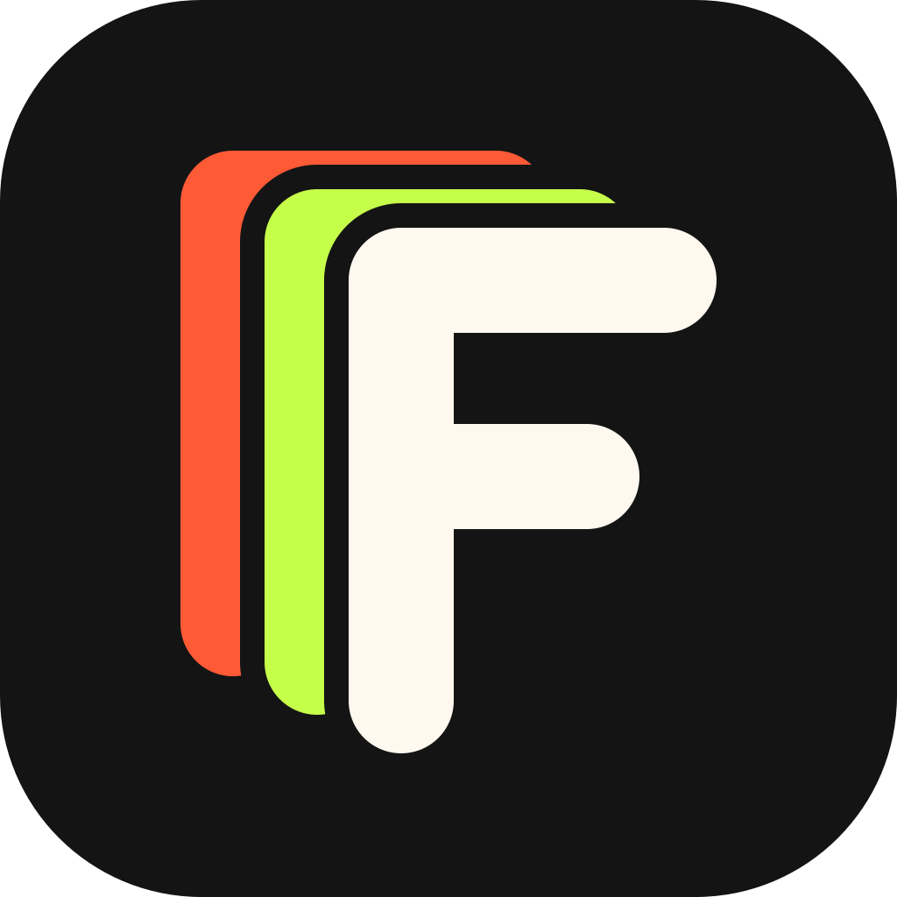
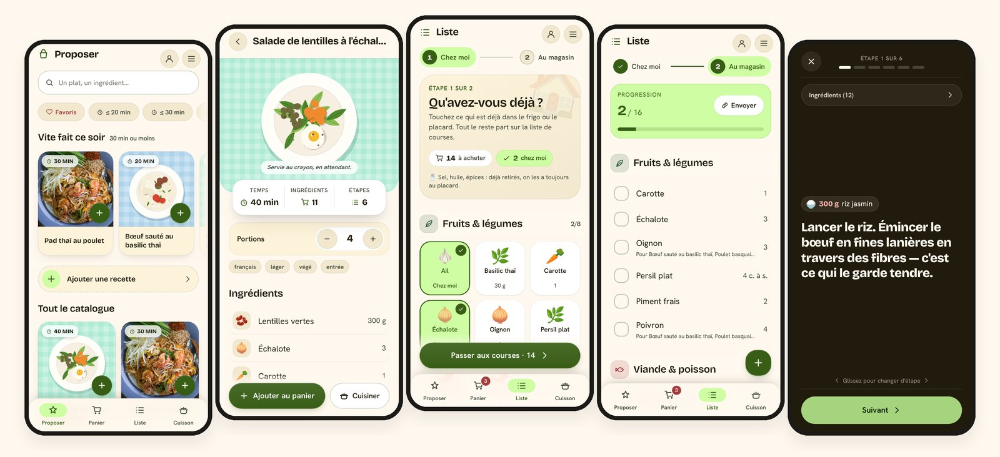
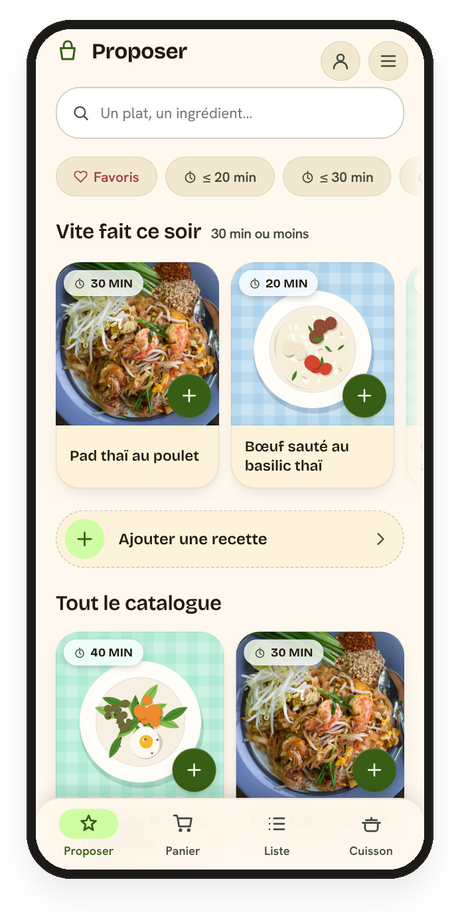
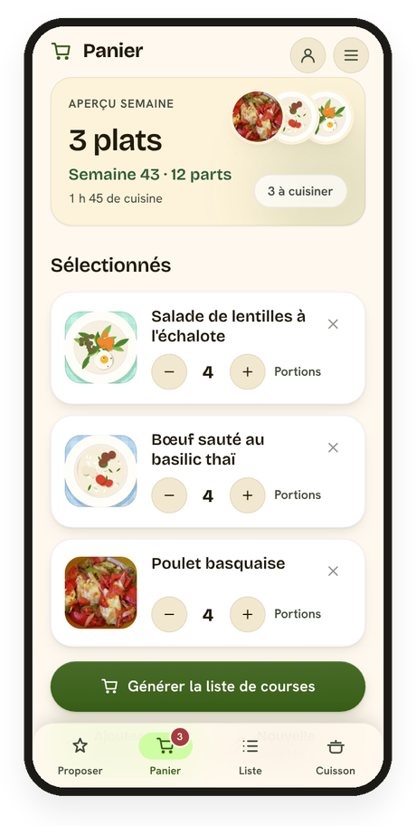
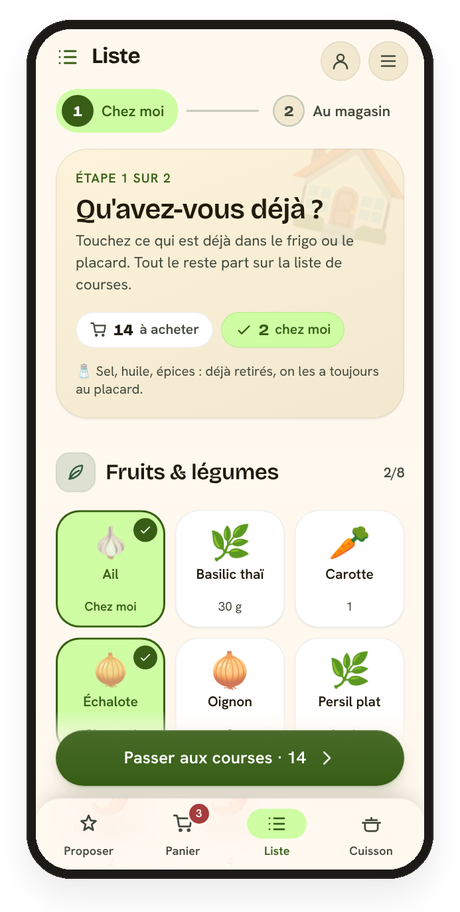
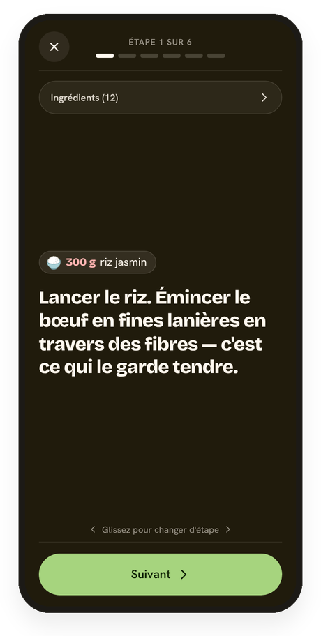
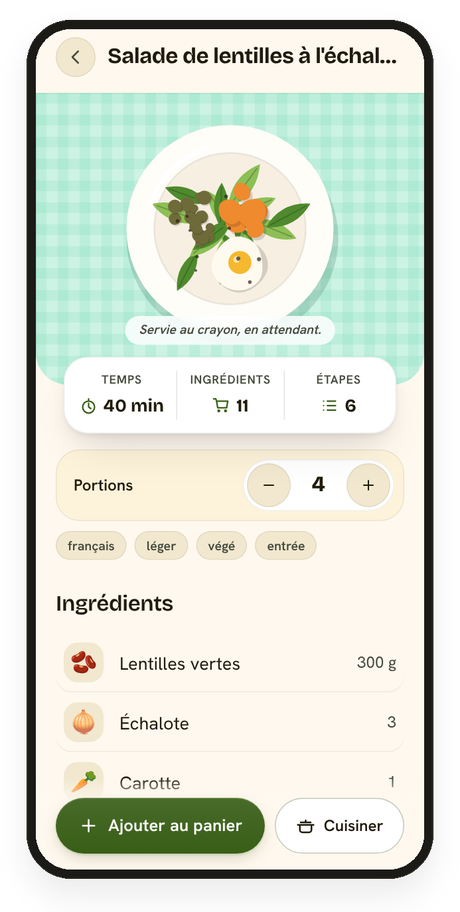
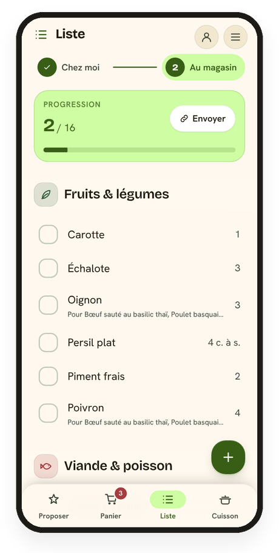
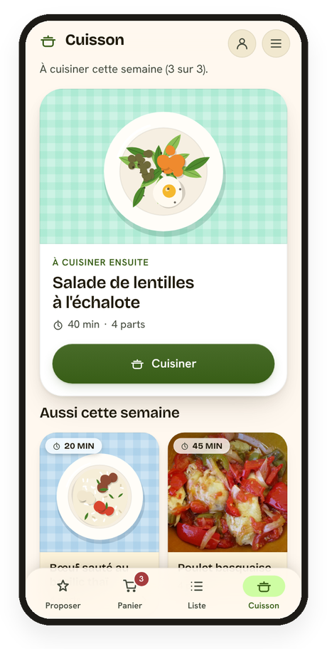
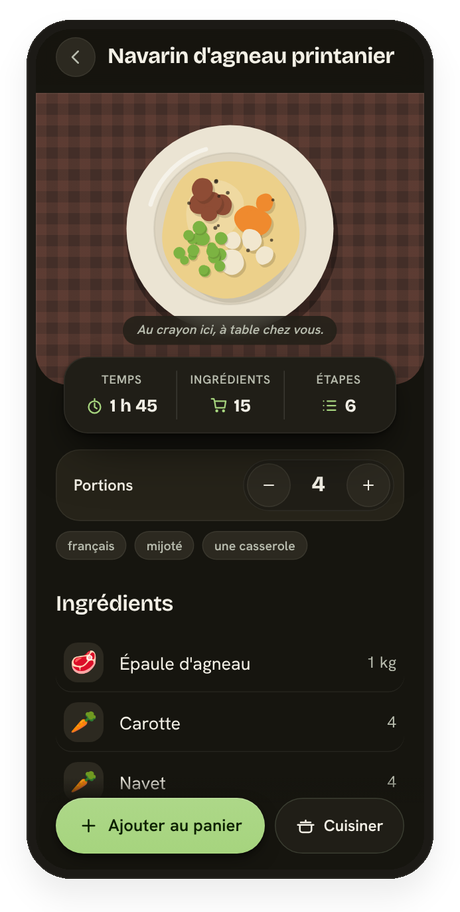

<div align="center">



# FFFood

### Qu'est-ce qu'on mange ce soir ? **Décidé.**

Choisir les repas de la semaine, en tirer la liste de courses, et cuisiner — à deux, sans compte, même sans réseau au magasin.

[**fffood.fr**](https://www.fffood.fr) · [Android & iOS](STORES.md) · [Comment c'est pensé](docs/CONCEPTION.md)


<br />



</div>

<br />

## ✨ En bref

**🍽️ Choisir** — un catalogue de **138 recettes** écrites à la main, des filtres sous le pouce, une rangée « Vite fait ce soir ». On ajoute ses propres recettes : à la main, depuis un lien, ou écrites par une IA.

**🛒 Faire les courses** — la liste **se fait seule** : ingrédients additionnés, rangés par rayon. On écarte d'abord ce qu'on a déjà chez soi, puis on coche en magasin, **même hors ligne**.

**👩‍🍳 Cuisiner** — étape par étape, en grand, l'écran reste allumé. Les doses de l'étape au-dessus, des **minuteurs** en un toucher, on glisse pour avancer.

> **À deux, sans compte.** Un code de six caractères ou un lien suffit pour partager la maison : même panier, même liste cochée en temps réel, mêmes recettes.
> Et pour donner des idées à quelqu'un d'autre, **le menu de la semaine s'envoie par un lien** : il remplit son panier d'un geste, sans entrer chez vous.

<br />

## 📱 La semaine, en quatre écrans

<table>
<tr>
<td align="center" width="25%"></td>
<td align="center" width="25%"></td>
<td align="center" width="25%"></td>
<td align="center" width="25%"></td>
</tr>
<tr>
<td align="center"><b>1 · Proposer</b><br /><sub>On pioche les plats de la semaine</sub></td>
<td align="center"><b>2 · Panier</b><br /><sub>On ajuste les portions</sub></td>
<td align="center"><b>3 · Liste</b><br /><sub>Chez moi, puis au magasin</sub></td>
<td align="center"><b>4 · Cuisson</b><br /><sub>Une étape à la fois</sub></td>
</tr>
</table>

<br />

## 🔍 Dans le détail

<table>
<tr>
<td width="38%" align="center"></td>
<td width="62%" valign="middle">

### La fiche recette

Photo bord à bord, puis les trois chiffres qu'on cherche avant de se décider : **temps, ingrédients, étapes**. Les portions se règlent avec de gros boutons et toutes les quantités suivent. Chaque ingrédient a son emoji.

</td>
</tr>
<tr>
<td width="62%" valign="middle">

### « Qu'avez-vous déjà ? »

Pas d'inventaire à tenir : quinze secondes devant le frigo ouvert. On touche les tuiles de ce qu'on a ; le reste part sur la liste. Sel, huile et épices sont déjà écartés.

</td>
<td width="38%" align="center"></td>
</tr>
<tr>
<td width="38%" align="center"></td>
<td width="62%" valign="middle">

### Au magasin

Rangée **par rayon**, et par magasin si on en fait plusieurs. Une jauge pour voir où on en est ; ce qui est pris descend dans « Dans le caddie ». On envoie la liste par SMS à qui n'a pas l'app.

</td>
</tr>
<tr>
<td width="62%" valign="middle">

### Ce soir, on cuisine quoi ?

Le prochain plat de la semaine à la une, un bouton pour commencer. Une séance interrompue reprend à la bonne étape ; les minuteurs tournent même quand on change d'écran.

</td>
<td width="38%" align="center"></td>
</tr>
</table>

<br />

<div align="center">

### 🌗 Clair ou sombre, comme le téléphone




</div>

<br />

## 🧭 Les principes

| | |
|---|---|
| 📦 **Les recettes sont un fichier** | `src/data/recipes.json` est embarqué au build : rien à charger, tout marche hors ligne, modifier une recette est un commit. |
| 🔑 **Un ingrédient = un nom canonique** | C'est la clé qui additionne la liste. `crème fraîche` partout, jamais `crème épaisse` — `npm run lint:recipes` y veille. |
| 🏠 **Pas de stock, une passe « chez moi »** | Un inventaire suppose de déclarer chaque consommation. Quinze secondes devant le frigo rendent l'essentiel du service. |
| 🔗 **Partage par lien, sans compte** | Qui a le lien a la liste. Le modèle est appliqué par la base (sessions anonymes, table `membres`), pas par l'app. |
| 📶 **Hors ligne d'abord** | Copie locale dans IndexedDB, la synchro rattrape au retour du réseau. Une app sans stockage démarre quand même. |
| 👍 **Annuler plutôt que confirmer** | Retirer un plat se rattrape d'un toucher ; seul ce qui ne se rattrape pas demande confirmation. |

Chaque décision, ce qu'elle évite et ce qu'elle coûte : **[docs/CONCEPTION.md](docs/CONCEPTION.md)**.

<br />

## 🚀 Démarrer

```bash
npm install
cp .env.example .env   # facultatif : sans ça, tout marche sauf le partage
npm run dev
```

Pour activer le partage entre téléphones, un projet [Supabase](https://supabase.com) gratuit suffit — les étapes sont dans [docs/CONCEPTION.md § Mise en route](docs/CONCEPTION.md#mise-en-route).

### Commandes

| Commande | Ce qu'elle fait |
|---|---|
| `npm run dev` | Serveur de développement |
| `npm run build` | Build de production + une page HTML par recette (`/recette/<id>/`) |
| `npm test` | Tests (`node:assert`, sans framework) |
| `npm run typecheck` | Vérification des types |
| `npm run lint:recipes` | Structure du corpus, quasi-doublons d'ingrédients, rayons incohérents |
| `npm run verifier` | Parité fr/en, crédits photo, traduction du corpus |
| `npm run ci` | Tout ce qui précède, dans l'ordre |
| `npm run mobile:android` · `mobile:ios` | Build + ouverture du projet natif ([STORES.md](STORES.md)) |

<br />

## 🧱 Sous le capot

<table>
<tr>
<td valign="top" width="50%">

**Stack**
- **React 18** + **TypeScript**, bundlé par **Vite**
- **PWA** (vite-plugin-pwa / Workbox) — installable, hors ligne
- **IndexedDB** (idb-keyval) pour la copie locale
- **Supabase** pour le partage en temps réel
- **Capacitor** pour les apps Android et iOS
- CSS écrit à la main, jetons de design et thème sombre

</td>
<td valign="top" width="50%">

**Arborescence**
```
src/
├── screens/      les écrans (Proposer, Panier, Liste, Cuisson…)
├── components/   formulaire, minuteurs, visite guidée…
├── lib/          agrégation, synchro, i18n, durées…
├── hooks/        minuteurs, mises à jour, installation…
├── data/         recettes (fr + en) et glossaire
└── styles.css    le système visuel
scripts/          prerender, lint du corpus, assets
supabase/         schéma et migrations
```

</td>
</tr>
</table>

**Deux langues**, français et anglais : le corpus est écrit en français, l'anglais vit à côté (`recipes.en.json`, `glossaire.en.json`) sans jamais toucher aux clés d'agrégation.

<br />

## ✍️ Ajouter une recette au corpus

```json
{
  "id": "dahl-lentilles-corail",
  "titre": "Dahl de lentilles corail",
  "temps": 30,
  "portions": 4,
  "tags": ["végé", "rapide"],
  "ingredients": [
    { "nom": "lentilles corail", "quantite": 250, "unite": "g", "rayon": "epicerie" },
    { "nom": "cumin moulu", "quantite": 1, "unite": "cc", "rayon": "epicerie", "placard": true }
  ],
  "etapes": ["Émincer l'oignon.", "…"]
}
```

1. **`nom`** canonique : minuscules, singulier, sans marque.
2. **`rayon`** du magasin, jamais une enseigne.
3. **`placard: true`** pour ce qu'on a toujours — exclu de la liste, affiché en cuisson.
4. Les quantités correspondent à **`portions`** ; l'app fait la règle de trois.

Puis `npm run lint:recipes` et `npm run verifier` (la traduction anglaise est exigée). Le détail : [docs/CONCEPTION.md § Écrire des recettes](docs/CONCEPTION.md#écrire-des-recettes).

<br />

## 📚 Pour aller plus loin

| Document | |
|---|---|
| [docs/CONCEPTION.md](docs/CONCEPTION.md) | Chaque choix et pourquoi : données, partage, hors ligne, rayons, SEO, mises à jour |
| [PARCOURS.md](PARCOURS.md) | Le besoin et le parcours utilisateur |
| [STORES.md](STORES.md) | Les apps Android et iOS (Capacitor) |
| [LANCEMENT.md](LANCEMENT.md) | La stratégie de lancement |

<br />

<div align="center">
<sub>Fait pour un foyer qui veut savoir ce qu'il mange ce soir — et le décider en trente secondes.</sub>
</div>
